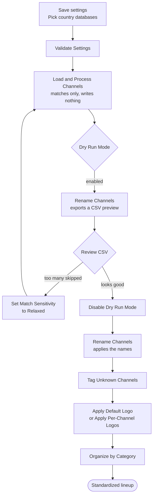
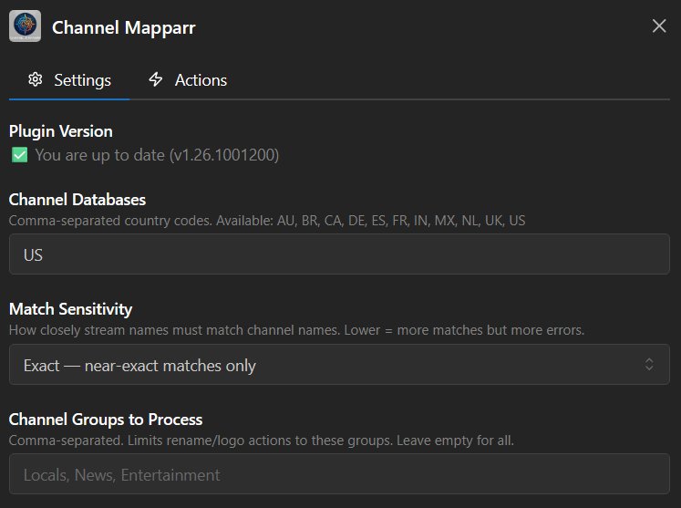
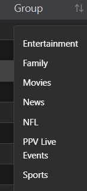

# 2. Channel Organization: Channel Mapparr

**Repository:** [Dispatcharr-Channel-Maparr-Plugin](https://github.com/PiratesIRC/Dispatcharr-Channel-Maparr-Plugin) &nbsp;  &nbsp; 

!!! info "Note the spelling"
    The repository is **Channel-Maparr** with one `p`, while the plugin displays as **Channel Mapparr**. If you are searching GitHub or the Dispatcharr plugin listing and coming up empty, that is why.

!!! info "Requires Dispatcharr v0.34.0 or later"
    From release `1.26.3251847` the settings page uses the collapsible sections and pick lists that Dispatcharr added in v0.34.0, and the plugin listing does not offer that release to an older Dispatcharr. Settings you saved with an earlier release are carried over and shown as already picked.

## Goal

Standardize the names of channels that already exist in Dispatcharr using country channel databases, and optionally re-organize them into category groups (News, Sports, Entertainment, and so on).

Thirteen country databases ship with the plugin: **AU, BR, CA, DE, ES, FR, IN, MX, NL, NO, PL, UK, US**.

!!! warning "Renaming is the main job, but two actions do create channels"
    Everything in the core sequence works on channels already in your lineup. Two optional actions add new ones: **Import M3U Streams** pulls streams in from an M3U source, and **Create Channels From Streams** builds one channel per broadcast station from streams that are not attached to anything yet. Earlier versions of this guide said the plugin never creates channels, which was true before **Create Channels From Streams** was added.

!!! danger "Back up your database first"
    This plugin makes bulk channel renames and group reassignments that cannot be undone. [Back up the Dispatcharr database](../prerequisites.md#back-up-the-database) before running any actions.

## Plugin Flow

!!! danger "Load & Process Channels does not rename anything"
    This trips people up. **Load &amp; Process Channels** only matches your channels against the databases and stores the result. Nothing is written to your lineup until you run **Rename Channels**. Earlier versions of this guide told you to run Load &amp; Process twice, which renames nothing at all.

## Configuration Options

The settings page is divided into collapsible sections; the four that most installs never change (Import M3U Streams, Create Channels From Streams, Emailed Reports and Anonymous Usage Counts) start closed. Seven settings are pick lists: you choose from the countries, groups or categories that exist instead of typing names.

- **Channel Databases:** Pick list of the country databases to load (default `US`). Pick at least one: with none picked, the logo actions and Validate Settings refuse to run.
- **Match Sensitivity:** `relaxed` / `normal` (default, threshold 80) / `strict` / `exact`. Use **relaxed** if real channels are being missed, **strict** or **exact** to avoid false positives. (There is no `loose` setting: earlier versions of this guide called it that.)
- **Dry Run Mode:** See the warning below: it does **not** cover every action.
- **Channel Groups to Process:** Pick list of every channel group. Limits renaming, tagging and logo actions to the groups picked; empty means every group.
- **Channel Groups to Ignore:** Pick list of every channel group. Channels in these groups are left alone by renaming, tagging, logos and Organize by Category, and an exclusion wins over Channel Groups to Process.
- Both group lists start with one wildcard pattern per group-name prefix, the text up to and including the first `:` or `|`. A group named `US| CBS` offers `US|*`, which picks every group whose name starts with `US|` in any letter case, and each pattern shows how many groups it matches, for example `US|* (93 groups)`. A pattern also covers a matching group added later. A group added since the plugin last loaded appears in the lists after you press the refresh control on the Plugins page.
- **Category Organization Groups:** Pick list of every channel group plus every category in the channel databases: the groups Organize by Category may move channels into or create. Empty means the categories named in the databases.
- **OTA Name Format:** Template using `{NETWORK}`, `{STATE}`, `{CITY}`, `{CALLSIGN}` (default `{NETWORK} - {STATE} {CITY} ({CALLSIGN})`).
- **Ignored Tags:** Tags stripped before matching (default `[4K], [FHD], [HD], [SD], [Unknown], [Unk], [Slow], [Dead]`). Handles both `[]` and `()` forms.
- **Unknown Channel Suffix:** Default `" [Unk]"` (with a leading space).
- **Default Logo:** Logo *display name* from Dispatcharr's Logo Manager, not the filename.
- **M3U Source**, **M3U Group Filter**, **Category Filter**, **Custom Import Group Name**: used by the **Import M3U Streams** action. M3U Group Filter is a pick list of the stream groups that hold a stream, applied before matching; Category Filter is a pick list of database categories, applied after matching.
- **Match by Market When No Callsign:** Default off. When a channel name gives a market and a channel number but no callsign, such as `ABC 9 HD [SYRACUSE]`, the station is looked up by market instead. A station is accepted only when exactly one fits, so an ambiguous market is left alone rather than guessed at. Leave it off to match on callsigns only.
- **Rate Limiting:** None / Low / Medium / High. Raise it if Dispatcharr starts returning errors during long runs.
- **Delete CSV Exports Older Than (Days):** Default **0, which keeps everything**. It runs after each export and only removes this plugin's own files from the shared export directory, never the file just written and never the last surviving one.

### Creating channels from unattached streams

**Create Channels From Streams** builds one channel per broadcast station from streams that are not attached to any channel. It is not the same as **Import M3U Streams**: that one creates a channel per *stream*, this one creates a channel per *station* and **attaches no streams at all**. You attach streams afterwards, usually with Stream-Mapparr.

- **Stream Groups to Seed From:** Pick list of the stream groups to scan, for example `US| ABC` and `US| CBS`. Only streams in these groups that are attached to nothing are considered. Empty means the action does nothing.
- **Channel Group to Create In:** The existing channel group the new channels land in. **The group must already exist**, and a group listed in Channel Groups to Ignore is refused.
- **First Channel Number to Use:** The first number to assign, for example `5110`. Numbers already in use are skipped, so you do not need a free block. Leave it empty to start above the highest channel number on the system.
- **Networks to Skip When Creating Channels:** Comma-separated network names, for example `Telemundo, Univision`. A station carrying one is reported and skipped rather than created. The network is read both from the station record and from the stream name, because a low power station record often names no network at all.

### Email reports through Newsflasharr

These three settings do nothing on their own. They hand a report to the separate **Newsflasharr** plugin, which is what actually sends mail.

- **Send notifications to Newsflasharr:** Default off. With Newsflasharr absent or disabled, nothing is sent and nothing fails.
- **Email A Report After:** `Never` or `Every run that produces an export` (default). Organize by Category only reports in Dry Run, because a real run of it produces no export.
- **Email Report Format:** `HTML`, `CSV`, or `Both`. A notification carries one attachment, so **Both** sends two separate emails per run rather than one email with two files. Either way both files are written to `/data/channel_mapparr_reports`; this setting only decides which get emailed.

!!! note "The emailed report is not the same file as the CSV export"
    The emailed report is built specifically for sending and never contains your M3U source names. The CSV exports in `/data/exports` do contain them, in their settings header. Keep that in mind before forwarding one on.

!!! warning "What Dry Run Mode produces differs by action"
    With **Dry Run Mode** on, no action writes to the database. **Rename Channels, Organize by Category, Replace Logos (tv-logos), Import M3U Streams and Create Channels From Streams** write a CSV preview to `/data/exports`. **Tag Unknown Channels, Apply Default Logo and Apply Per-Channel Logos** only report a count of what they would have done and write no file, so you see how many channels they would change but not which.

    Earlier versions of this guide said those three wrote even with Dry Run on; that was true before release `1.26.2481147`. Back up before you run any of them for real the first time.

## Action Sequence

1. Save settings and select the country databases you want loaded.
2. Run **Validate Settings** to confirm configuration.
3. Run **Load & Process Channels** to match your channels against the databases. This writes nothing to your lineup.
4. Enable **Dry Run Mode** and run **Rename Channels** to export a CSV preview of the proposed names.
5. Review the CSV. If too many channels are skipped, set **Match Sensitivity** to `relaxed`, re-run Load & Process, and preview again.
6. Disable **Dry Run Mode** and run **Rename Channels** to apply the standardized names.
7. Optionally run **Tag Unknown Channels** to flag whatever did not match. With Dry Run on it reports how many channels it would tag; turn Dry Run off to write.
8. Optionally run **Apply Default Logo** (a single fallback logo) or **Apply Per-Channel Logos** (fuzzy-matches each channel against the public tv-logos repository). With Dry Run on each reports a count; turn it off to write.
9. For category sorting, run **Organize by Category**, with **Dry Run Mode** on first to preview, then again with it off to commit.
10. Use **Import M3U Streams** if you need to pull streams from an M3U source, **Show Status** to check on a run, and **Clear CSV Exports** to clean up old preview files.
11. If you are building a lineup from scratch, run **✚ Create Channels** with **Dry Run Mode** on to preview which stations would be created, then again with it off. Attach streams afterwards with Stream-Mapparr.
12. If you use Newsflasharr for mail, **📧 Email Report Now** sends a report from the last processed channels. It checks that Newsflasharr is installed, enabled, configured and routed, and refuses rather than queueing a report nobody will receive. Queued means written to Newsflasharr's queue, not that it has reached your inbox.

## Important Notes

- Use the *display name* from the Dispatcharr Logos page for **Default Logo**, not the filename.
- Always preview with **Dry Run Mode** before running Rename or Organize for the first time on a profile. They touch many channels at once.
- **Over-the-air channels are matched by the callsign found in the existing channel name.** A callsign that is also an ordinary English word (KING, WHO, WOLF, WAVE, WOOD) is only accepted with corroboration, so a channel named `24/7 KING OF THE HILL` is reported as **skipped** rather than renamed into a Seattle NBC station. If you expected such a channel to be renamed and it was not, this guard is why.
